<picture>
  <source media="(prefers-color-scheme: dark)" srcset="https://raw.githubusercontent.com/Bigpineapple1024/Bigpineapple1024/output/hero.svg" />
  <source media="(prefers-color-scheme: light)" srcset="https://raw.githubusercontent.com/Bigpineapple1024/Bigpineapple1024/output/hero-light.svg" />
  
</picture>

修士在读，研究多模态理解与 token 剪枝。 
修士課程在籍。マルチモーダル理解とトークン削減を研究中。 
Master's student researching multimodal AI and token pruning.

<picture>
  <source media="(prefers-color-scheme: dark)" srcset="https://raw.githubusercontent.com/Bigpineapple1024/Bigpineapple1024/output/github-snake-dark.svg" />
  <source media="(prefers-color-scheme: light)" srcset="https://raw.githubusercontent.com/Bigpineapple1024/Bigpineapple1024/output/github-snake.svg" />
  
</picture>

